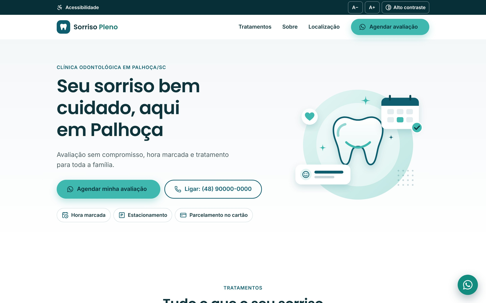
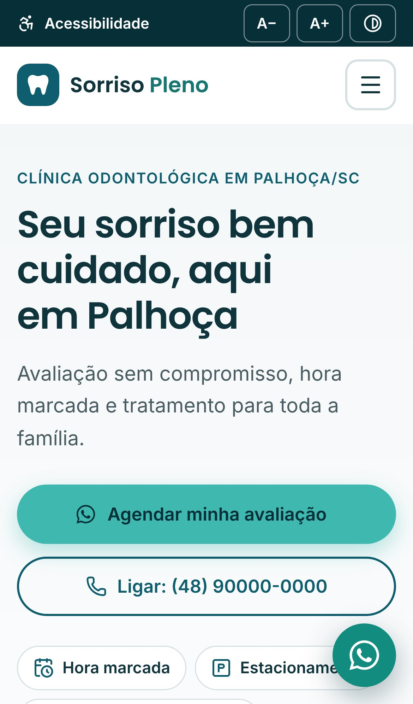
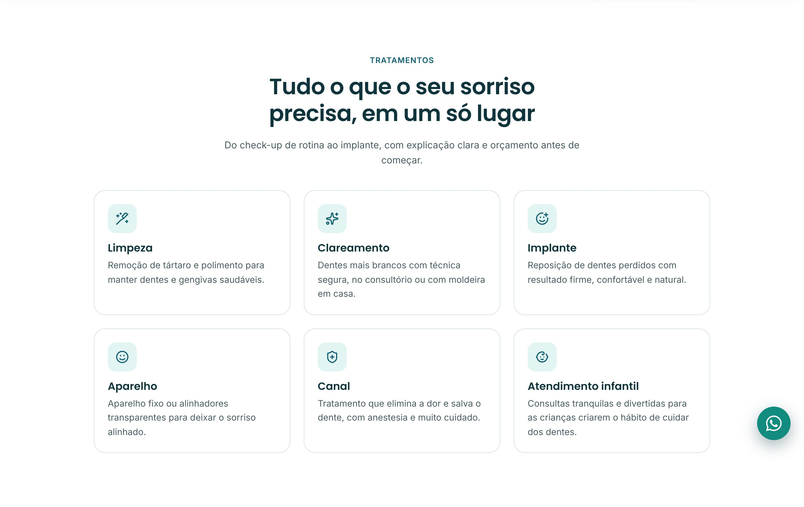

# Clínica Sorriso Pleno · Landing page de serviço local

> **Projeto conceitual de portfólio.** Empresa, pessoas, preços, telefones, endereço e depoimentos são fictícios.

Landing page de uma clínica odontológica fictícia em Palhoça/SC. O objetivo da página é levar o visitante a agendar uma avaliação pelo WhatsApp, com a ligação como ação secundária.

**Ver online:** https://gabrielgandra1.github.io/lp-clinica-sorriso-pleno/



| Celular com botão flutuante | Seção de tratamentos |
| --- | --- |
|  |  |

## O que a página tem

- Topo fixo com menu (Tratamentos, Sobre, Localização) e botão do WhatsApp; no celular, menu sanduíche.
- Abertura com título, botões de agendar e ligar e três selos (hora marcada, estacionamento, parcelamento).
- Seis tratamentos, quatro diferenciais, equipe, depoimentos, perguntas frequentes, localização com mapa, chamada final e rodapé.
- Link do WhatsApp no formato `wa.me` com mensagem pronta e botão flutuante em todas as telas.
- Rolagem suave até as seções e animação leve ao rolar.

## Acessibilidade (WCAG 2.2 nível AA)

- HTML semântico com landmarks, um único `h1` e hierarquia de títulos.
- Link "Pular para o conteúdo principal".
- Barra de acessibilidade: aumentar e diminuir o texto (até 137,5%) e alto contraste. A preferência fica salva no navegador e as mudanças são anunciadas ao leitor de tela.
- VLibras (tradução para Libras), carregado na primeira interação para não pesar na abertura da página.
- Navegação completa por teclado, foco sempre visível, menu com `aria-expanded` que fecha com Esc e devolve o foco.
- Contraste mínimo de 4,5:1 nos textos, respeito à preferência "reduzir movimento" e suporte ao modo de cores forçadas do Windows.
- Áreas de toque com pelo menos 44 px e layout sem rolagem horizontal em 320 px, mesmo com o texto ampliado.
- Perguntas frequentes com `details` e `summary`, que funcionam sem JavaScript.

## SEO

- Título, descrição, URL canônica, Open Graph e Twitter Card com imagem de 1200 × 630 px.
- Dados estruturados em JSON-LD: `Dentist` (negócio local), `WebSite` e `FAQPage`.
- `sitemap.xml`, `robots.txt`, favicon (SVG, ICO e PNG), `site.webmanifest` e página 404.

## Desempenho

- Sem framework e sem dependências externas de JavaScript.
- Fontes hospedadas no próprio projeto em WOFF2, com `preload` e `font-display: swap`.
- Ilustrações em SVG de poucos KB, imagens com largura e altura definidas e mapa com `loading="lazy"`.

## Resultados medidos

Medição em servidor local, antes da publicação.

| Ferramenta | Desempenho | Acessibilidade | Boas práticas | SEO |
| --- | --- | --- | --- | --- |
| Lighthouse 13.6, celular | 99 a 100 | 100 | 100 | 100 |
| Lighthouse 13.6, computador | 100 | 100 | 100 | 100 |

axe-core 4.14 (regras WCAG 2.0, 2.1 e 2.2 A/AA e boas práticas): nenhuma violação no computador, no celular, com o menu aberto e com alto contraste e texto no tamanho máximo.

## Tecnologias

HTML5, CSS3 (variáveis, grid, `clamp()`) e JavaScript puro (`IntersectionObserver`, `matchMedia`, `localStorage`).

## Estrutura

```text
.
├── index.html
├── 404.html
├── css/styles.css
├── js/main.js
├── assets/
│   ├── fonts/    Inter e Poppins em WOFF2
│   ├── icons/    favicon e ícones do app
│   └── img/      ilustrações SVG e imagem de compartilhamento
├── prints/       imagens para o portfólio
├── site.webmanifest
├── robots.txt
└── sitemap.xml
```

## Rodar localmente

Qualquer servidor estático serve. Com Python:

```bash
python3 -m http.server 8080
```

Depois, abra `http://localhost:8080`.

## Como personalizar

- **WhatsApp e telefone:** troque `5548900000000` no `index.html` (links `wa.me` e `tel:`).
- **Mensagem pronta:** parâmetro `text` do link `wa.me`, codificado para URL.
- **Cores e fontes:** variáveis no início do `css/styles.css`.
- **Fotos:** as ilustrações de `assets/img` podem ser trocadas por fotos em WebP (Unsplash ou Pexels), mantendo `width` e `height` no HTML.
- **Domínio próprio:** atualize as URLs absolutas (canonical, Open Graph, JSON-LD, `sitemap.xml` e `robots.txt`).

## Créditos

- Fontes: [Inter](https://rsms.me/inter/) e [Poppins](https://fonts.google.com/specimen/Poppins), licença SIL Open Font License 1.1, obtidas via Fontsource.
- Ícones: [Lucide](https://lucide.dev) (licença ISC) e [Font Awesome Free](https://fontawesome.com) para os ícones de marcas (CC BY 4.0).
- Ilustrações: criadas em SVG para este projeto.

## Licença

Código sob a licença MIT. Veja [LICENSE](LICENSE).
